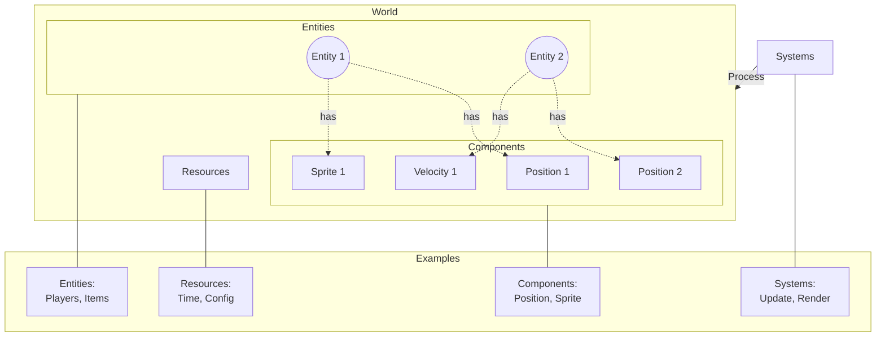

# Rust ECS Game Template

A flexible, modular game development foundation built in Rust using the Entity Component System (ECS) architectural pattern. This template provides a clean starting point for building 2D games, featuring [Raylib](https://www.raylib.com/) for rendering and input handling.

## Overview

This project serves as a foundation for game development, emphasizing:

- Clean architecture through ECS principles
- Modular design for easy extension and modification
- Type-safe component and resource management
- Zero-cost abstractions using Rust's type system

## Architecture

The engine implements a pure ECS architecture where Systems operate on a World container that manages Entities, Components, and Resources.



### Core Elements

#### Entities

Entities are unique identifiers that serve as anchors for components. They represent distinct objects in your game world, such as:

- Players
- Enemies
- Projectiles
- Items
- UI elements

Each entity is essentially an ID that can have multiple components attached to it:

```rust
pub struct Entity(pub u64);
```

#### World

Central container managing:

- Entity creation and removal
- Component storage and access
- Resource storage and access

#### Components

Pure data structures attached to entities. Examples include:

```rust
// Position in 2D space
pub struct PositionComponent {
    pub coords: Vector2,
}
```

#### Resources

Global state shared across systems:

```rust
pub struct GameTime {
    pub total: f32,
}
```

#### Systems

Independent logic modules in two categories:

Update Systems:

```rust
pub trait UpdateSystem {
    fn run(world: &mut World, raylib_handle: &RaylibHandle, config: &GameConfig);
}
```

```rust
pub trait RenderSystem {
    fn run(world: &mut World, draw_handle: &mut RaylibDrawHandle, config: &GameConfig);
}
```

## How to Use This Template

This template is designed to be modified. To get started:

1. **Define Your Components**: Replace or modify existing components to represent your game objects
2. **Add Resources**: Create resources to manage your game's global state
3. **Implement Systems**: Build game logic through update and render systems
4. **Configure Game Flow**: Arrange systems in your desired execution order

Each step is designed to be modular, allowing you to extend or modify the functionality as needed.

## Technical Features

- Macro-generated storage systems for type-safe component and resource management
- Clear separation between update and render systems
- Built-in game state management
- Configurable game parameters
- Builder pattern for game initialization
