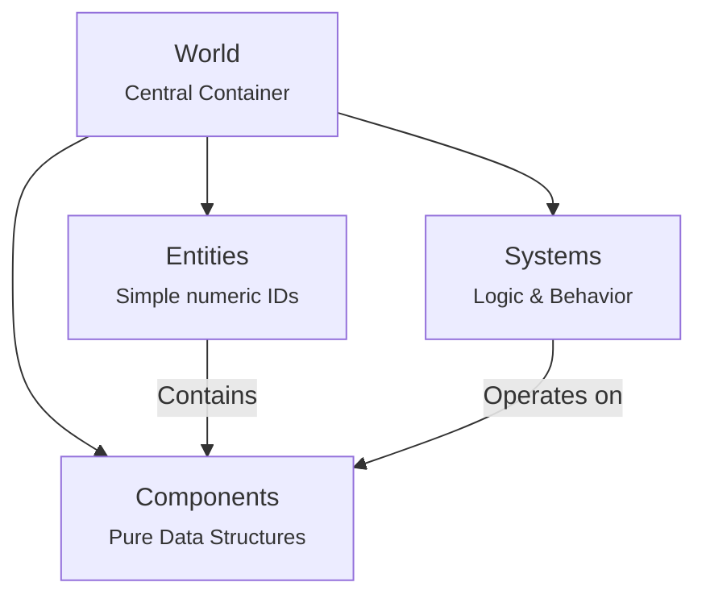

# Rust ECS Game Engine

A minimalist game engine foundation built in Rust using the Entity Component System (ECS) pattern. This project provides a clean, modular architecture for 2D game development, with Raylib handling the rendering and input layers.

## Entity Component System Architecture

The engine strictly follows ECS principles, separating data from behavior to provide flexibility and performance.



### Core Elements

#### World Container

The `World` struct serves as the central manager for all ECS elements. It provides:

- Entity creation and management
- Component storage and access
- System execution context

#### Components

Components are pure data structures that define properties. Adding new components is as simple as:

```rust
pub struct MyComponent {
    pub value: f32,
    pub active: bool,
}
```

#### Systems

Systems contain the game logic and operate on entities with specific component combinations:

```rust
pub trait UpdateSystem {
    fn run(world: &mut World, raylib_handle: &RaylibHandle);
}
```

## Getting Started

1. **Define Components**: Create data structures for your game objects
2. **Implement Systems**: Add behavior that operates on your components
3. **Register Components**: Use the `define_component_storages` macro to add storage
4. **Configure Game Loop**: Arrange your systems in the desired update order

## Technical Features

- Zero-cost abstractions through Rust's type system
- Macro-based component storage generation
- Clean separation of concerns through ECS architecture
- Raylib integration for graphics and input handling
- Builder pattern for game initialization
